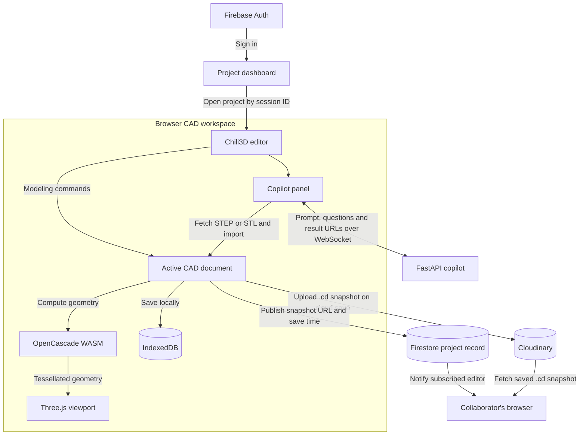

# Venus CAD

Venus brings a GitHub-style project workflow to 3D CAD. A team can open a shared model in the browser, discuss a design change in the editor, and see who saved the next revision.

We built Venus on [Chili3D](https://github.com/xiangechen/chili3d), which provides the CAD editor, modeling commands, OpenCascade geometry kernel, and Three.js viewport. Our work adds the project dashboard, team workspaces, sharing and save history, live collaboration, and an AI copilot that imports generated parts into the editor.

[Website](https://venuscad.pages.dev/) · [Demo video](https://drive.google.com/file/d/1jjj3zXOGLyOmLG7YZgZWUv611T0uTkyC/view?usp=sharing) · [Backend repository](https://github.com/Ruthwik000/venus_be)

## Working on a shared model

- **Team creation.** Open **Teams** on the dashboard and choose **Create Team**. Name the team, then create its first project or select one you already own. Invite teammates by selecting friends or entering email addresses. From the team page, you can manage members and add more projects.
- **Project sharing.** Invite a collaborator to view or edit a specific design, or review a request for access. The dashboard brings together projects you own, projects shared with you, and projects you have starred.
- **Live collaboration.** Presence indicators show who has the project open. Teammates can leave comments on the design or discuss a change in project chat. When someone saves the model to the cloud, other open editors reload the saved snapshot.
- **Project history.** A project's activity log records events such as creation and saves, along with the contributor, timestamp, and description. Teammates can follow the sequence of changes from the dashboard.
- **AI copilot.** Ask for a part such as a mounting bracket, then answer questions about its dimensions and features. The backend generates a FreeCAD model and returns STEP and STL files. The editor imports the result into the current document. You can request a revision in the same chat and save the part with the rest of the project.

## Parametric design variations

Native parametric shapes, including boxes and cylinders, retain their editable dimensions. For example, create a cylinder with a radius of 10 and a height of 20. Select it, open **Properties**, and change **Height** to 30. The editor rebuilds the cylinder at the new height and keeps its radius. You can export each size separately or save the editable document as a native `.cd` file.

For a copilot-generated part, describe the variation in the same chat. For example, ask “Increase the mounting holes from 4 mm to 6 mm and keep their centers fixed.” The backend revises the saved FreeCAD script and the editor imports the resulting model.

## Import and export

Use **Import** to add one or more files to the active document. Use **Export** to choose the model or models to write. STEP is useful for exchanging solid geometry with another CAD system. STL produces a mesh for a 3D-printing slicer.

| Format | Import | Export |
| --- | --- | --- |
| STEP | `.step`, `.stp` | `.step` |
| IGES | `.iges`, `.igs` | `.iges` |
| BREP | `.brep` | `.brep` |
| STL | `.stl` | `.stl` (ASCII or binary) |
| PLY | — | `.ply` (ASCII or binary) |
| OBJ | — | `.obj` |

## Frontend architecture

The browser runs the TypeScript editor and computes geometry locally with OpenCascade compiled to WebAssembly. The project session ID connects the open document to its Firestore project record and copilot conversation.



A project save and an AI generation produce different files. **Save** writes the editor document to IndexedDB. For a cloud project, it also uploads a native `.cd` snapshot to Cloudinary and updates Firestore with the snapshot URL and save time. Other editors use that URL to load the new document. [Save command](packages/chili/src/commands/application/saveDocument.ts) · [Project sync](packages/chili-web/src/pages/editor.ts)

The **copilot** sends prompts to FastAPI over a WebSocket. When the backend returns model URLs, the browser fetches the STEP file, or STL if only that format is available, and adds the geometry to the open document. The next project save includes the imported part. [Copilot panel](packages/chili-ui/src/aiChat/aiChat.ts) · [Backend architecture](https://github.com/Ruthwik000/venus_be#backend-architecture)

## Local development

Use Node.js 24 and npm from the repository root. The frontend includes the compiled WebAssembly module.

```sh
npm install
```

Copy `.env.example` to `.env`. To run the copilot locally, start the Python service using the [backend setup guide](https://github.com/Ruthwik000/venus_be#run-locally) and set these frontend values before starting the dev server.

```dotenv
VITE_BACKEND_WS_URL=ws://localhost:8000
VITE_BACKEND_HTTP_URL=http://localhost:8000
```

Firebase Auth and Firestore use the project configured in the Firebase client. Point that client at your development Firebase project when using your own data. The current cloud-save implementation signs uploads in the browser, so a Cloudinary signing secret supplied to the frontend is visible in the bundle. Keep production signing credentials on the server. [Firebase client](packages/chili-core/src/firebase.ts) · [Cloudinary client](packages/chili-core/src/cloudinary.ts)

```sh
npm run dev
```

Open the [local frontend](http://localhost:8081). Run `npm test` for the frontend test suite, `npm run build` for a production build, and `npm run preview` to serve that build locally. For changes to the C++ geometry bindings, see the [WebAssembly build guide](cpp/README.md).

## Source guide

| Area | Location |
| --- | --- |
| Sign-in, dashboard, and project routes | [chili-web](packages/chili-web/src) |
| Project records, sharing, teams, and live subscriptions | [Firebase services](packages/chili-core/src/firebase.ts) and [collaboration services](packages/chili-core/src/collaboration.ts) |
| Copilot, comments, chat, and presence controls | [chili-ui](packages/chili-ui/src) |
| Modeling commands and document editing | [chili](packages/chili/src) |
| Geometry and rendering | [OpenCascade bindings](packages/chili-wasm) and [Three.js integration](packages/chili-three) |

## Credits and license

The ProteinX team developed the Venus collaboration features and copilot integration on top of the Chili3D editor. The frontend is distributed under the [GNU AGPL v3](LICENSE). The C++ WebAssembly module carries its own [GNU LGPL v3 license](cpp/LICENSE-chili-wasm.txt).
